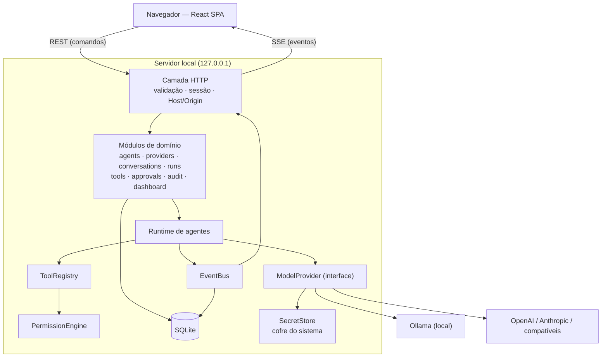
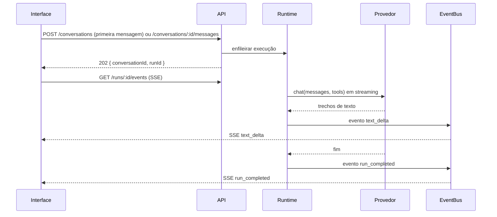

# ARCHITECTURE — Documentação arquitetural

> Estado: Fase 7. Está implementado tudo o que este documento descreve, exceto ferramentas, permissões, aprovações e delegação (`tools`, `PermissionEngine`, seções 5.2 e 5.3), que são projeto da Fase 8 e serão confirmados ou corrigidos quando forem escritos.

## 1. Visão geral

Monólito modular local. Um único processo Node serve a API e a interface já compilada, com um banco SQLite em arquivo. Não há serviços externos obrigatórios.



## 2. Stack

| Camada | Tecnologia |
|---|---|
| Linguagem | TypeScript estrito |
| Monorepo | npm workspaces |
| Backend | Node 22, Fastify, Zod |
| Banco | SQLite (`better-sqlite3`), Drizzle ORM e migrações |
| Tempo real | Server-Sent Events |
| Frontend | React 19, Vite, Tailwind CSS 4, TanStack Query, React Router 7, lucide-react (ícones), Bricolage Grotesque (fonte embutida) |
| Segredos | `@napi-rs/keyring` (Credential Manager / Keychain / Secret Service) |
| Testes | Vitest, `fastify.inject`, Testing Library, Playwright |

## 3. Estrutura de diretórios

```
/
├─ apps/
│  ├─ server/
│  │  ├─ src/
│  │  │  ├─ config/        # leitura e validação do ambiente
│  │  │  ├─ core/          # erros de domínio, usados por todas as camadas
│  │  │  ├─ db/            # esquema Drizzle, migrações, conexão
│  │  │  ├─ http/          # servidor, plugins, tratamento de erros, SSE
│  │  │  ├─ security/      # sessão, Host/Origin, SecretStore, redação de logs
│  │  │  ├─ modules/       # um diretório por domínio (rotas, serviço, repositório)
│  │  │  ├─ runtime/       # loop do agente, limites, cancelamento, EventBus
│  │  │  ├─ providers/     # ModelProvider e adaptadores
│  │  │  └─ tools/         # ToolRegistry, PermissionEngine, ferramentas
│  │  └─ test/
│  └─ web/
│     ├─ src/
│     │  ├─ app/           # rotas, layout, provedores de contexto
│     │  ├─ components/    # componentes visuais reutilizáveis
│     │  ├─ features/      # dashboard, agents, chat, models, tools, logs, office
│     │  └─ lib/           # cliente de API, cliente SSE, utilitários
│     └─ e2e/              # Playwright
├─ packages/
│  └─ shared/              # esquemas Zod e tipos compartilhados (contrato da API)
├─ data/                   # banco e pastas de trabalho (ignorado pelo git)
└─ *.md                    # documentação
```

## 4. Componentes e responsabilidades

| Componente | Responsabilidade | Não faz |
|---|---|---|
| Camada HTTP | Roteamento, validação de entrada e saída, sessão, formato de erro, SSE. | Regra de negócio. |
| Módulos de domínio | Regras de negócio e persistência de cada entidade. | Chamar provedores diretamente. |
| Runtime | Conduzir uma execução: fila, chamar o modelo, despachar ferramentas, aplicar limites, cancelar. | Decidir permissões; ler ou gravar o banco (recebe o plano da execução e entrega o resultado por interfaces que o módulo `runs` implementa). |
| ModelProvider | Traduzir uma requisição neutra para a API de cada provedor e devolver um fluxo de eventos neutro. | Conhecer agentes ou ferramentas concretas. |
| ToolRegistry | Catálogo de ferramentas, com esquema de entrada e nível de risco. | Autorizar. |
| PermissionEngine | Decidir `allow`, `ask` ou `deny` para cada chamada, a partir da configuração do agente. | Executar. |
| EventBus | Receber eventos do runtime, persistir os passos (por uma função que o módulo `runs` fornece) e distribuir aos assinantes SSE. Trechos de texto do modelo são só distribuídos. | Interpretar eventos. |
| SecretStore | Guardar e recuperar credenciais no cofre do sistema. | Expor segredos à camada HTTP. |

Regra de dependência: `http → modules → runtime → providers/tools`. Camadas internas não importam as externas. O pacote `shared` não depende de nada do servidor nem da interface.

## 5. Fluxos de dados

### 5.1 Mensagem de chat com streaming



O POST retorna imediatamente; o progresso chega pelo SSE. Se a conexão cair, o navegador reabre o SSE informando o último evento recebido (`Last-Event-ID`) e o servidor reenvia o que faltou a partir do banco.

Há dois fluxos de eventos:

| Fluxo | Conteúdo | Retomada |
|---|---|---|
| `GET /api/runs/:id/events` | Uma execução. Abre com `snapshot` (estado e todo o texto já escrito), depois `step` (cada passo, com `id` igual à sequência), `delta` (trecho de texto), `status` e, ao final, `end`, quando o servidor fecha a conexão. | Passos depois do `Last-Event-ID`; o texto vem inteiro no `snapshot`, que substitui o que a tela tinha. |
| `GET /api/events` | Uma linha `run` a cada mudança de estado de qualquer execução. As telas (painel, escritório, listas) apenas recarregam os dados. | Nenhuma: ao reconectar chega `hello` e a tela recarrega tudo. |

Os trechos de texto não são gravados um a um: o texto completo vira uma mensagem ao fim da execução, mesmo quando ela é interrompida. Como salvaguarda, a interface também consulta a conversa a cada 2 s enquanto há execução ativa, e os dados gerais a cada 15 s.

### 5.2 Chamada de ferramenta com aprovação

Tudo acontece em um só lugar, `RunManager.dispatch`:

1. O modelo emite uma ou mais chamadas de ferramenta; elas são atendidas uma por vez, na ordem.
2. O `PermissionEngine` responde, a partir das permissões do agente e das ferramentas ligadas na instalação:
   - `deny`: o modelo recebe um resultado de erro e a execução continua;
   - `allow` ou `ask`: segue.
3. O runtime valida os argumentos contra o esquema Zod da ferramenta; inválidos viram erro para o modelo.
4. Se a decisão foi `ask`, cria-se uma aprovação, a execução vai para `waiting_approval`, o relógio do tempo máximo para e o runtime aguarda.
5. O usuário decide pela interface (`POST /api/approvals/:id/decision`). Aprovado, a ferramenta executa; negado, o modelo recebe a negativa (e o motivo) como resultado. Se a execução for interrompida enquanto espera, o pedido é retirado.
6. O resultado volta ao modelo rotulado como dado, e o laço continua até o modelo responder sem pedir ferramentas ou até um limite.
7. Cada etapa vira `run_step` (`tool_call_requested`, `approval_requested`, `approval_decided`, `tool_call_finished`), a chamada fica em `tool_calls` e, para risco médio ou alto, há registro de auditoria.

O texto que o modelo escreve entre uma ferramenta e outra fica na resposta final, em parágrafos. Só essa resposta é gravada como mensagem da conversa.

### 5.3 Delegação

`delegate_to_agent` é uma ferramenta como as outras, sujeita às mesmas permissões. Ao executar, o runtime pede ao módulo `runs` uma execução filha (`parent_run_id`, origem `delegation`) para o agente alvo, com uma conversa própria cuja primeira mensagem é a tarefa; a criação é recusada se o agente não existe ou não pode trabalhar, se a cadeia passaria da profundidade máxima ou se o agente já está nela. A filha roda na hora, fora da fila (a de origem já ocupa uma vaga e está esperando), com o modelo, os limites, as permissões e a pasta do agente alvo. A resposta dela é o resultado da ferramenta. Interromper a execução de origem interrompe as filhas; enquanto uma filha espera aprovação, o relógio das execuções acima dela também para.

## 6. Contratos internos

Formas simplificadas; a definição final fica em `packages/shared` e `apps/server/src/providers`.

```ts
interface ModelProvider {
  listModels(): Promise<ModelInfo[]>;
  testConnection(): Promise<ConnectionResult>;
  chat(request: ChatRequest, signal: AbortSignal): AsyncIterable<ChatEvent>;
}

type ChatEvent =
  | { type: 'text_delta'; text: string }
  | { type: 'tool_call'; id: string; name: string; arguments: unknown }
  | { type: 'usage'; inputTokens: number; outputTokens: number }
  | { type: 'done'; stopReason: 'end' | 'tool_use' | 'max_tokens' };

interface ToolDefinition<I> {
  name: string;
  description: string;
  inputSchema: ZodType<I>;
  risk: 'low' | 'medium' | 'high';
  execute(input: I, ctx: ToolContext): Promise<ToolResult>;
}
```

Estado em código (Fase 8): `ModelProvider` tem `testConnection`, `listModels` e `chat`, cada um aceitando um `AbortSignal`. `ChatRequest` leva as ferramentas oferecidas (`tools`), as mensagens podem ser de usuário, do agente (com chamadas de ferramenta) ou resultado de ferramenta, e `ChatEvent` tem `tool_call`. O motivo de parada é `end`, `max_tokens`, `refusal` ou `tool_use`. `ToolDefinition` tem ainda `title` e `summary` (textos para o usuário) e `offByDefault`.

Contratos do runtime (`apps/server/src/runtime/types.ts`):

```ts
interface RunPlan {          // resolvido quando a execução começa, não quando entra na fila
  provider: ModelProvider; model: string; system: string; messages: ChatMessage[];
  temperature: number; maxOutputTokens: number;
  limits: { maxSteps: number; maxDurationMs: number; maxTotalTokens: number | null };
  knownSecrets: string[];    // para redigir o que for ao log
  tools: ToolDefinition[];   // oferecidas ao modelo; oferecer não é permitir
  grants: Map<string, ToolPermission>; enabledTools: Set<string>;   // o que o PermissionEngine consulta
  workspaceDir: string;
}
interface RunStore {         // implementado em modules/runs/repository.ts
  begin(runId: string): void;
  finish(runId: string, outcome: RunOutcome): void;   // estado final, motivo, uso, texto
  setStatus(runId, status): void;                     // running <-> waiting_approval
  createToolCall / updateToolCall / createApproval / resolveApproval / auditToolCall
}
```

Passos gravados: `run_started`, `model_call_started`, `model_call_finished`, `tool_call_requested`, `approval_requested`, `approval_decided`, `tool_call_finished`, `delegation_started`, `delegation_finished`, `error`, `run_finished`. O tipo é texto livre, então um passo novo não exige migração; a interface mostra pelo nome um tipo que não conhece. O motivo de término (`runs.end_reason`) segue a lista `RUN_END_REASONS` de `packages/shared/src/runs.ts`.

Adaptadores lançam apenas `ProviderError`, cuja mensagem é uma frase fixa escolhida pelo tipo do erro (`unreachable`, `timeout`, `unauthorized`, `not_found`, `rate_limited`, `rejected`, `server_error`, `invalid_response`, `cancelled`, `program_missing`, `not_signed_in`). O texto vindo do provedor fica em `upstreamDetail`, só para log e só depois de redigido. Toda resposta de provedor é validada com Zod.

`ToolContext` carrega o agente, a execução, a pasta de trabalho, o `AbortSignal` e a função de delegar. Uma ferramenta nunca recebe acesso direto ao banco nem ao `SecretStore`.

Ferramentas embutidas ficam em `apps/server/src/tools/builtin/` e são registradas em `createBuiltinRegistry()`. As ferramentas ligadas na instalação ficam na tabela `settings` (chave `tools.enabled`); as permissões por agente, em `agent_tools` (ausência de linha é bloqueio). A Fase 8 não exigiu migração: as tabelas já existiam desde a Fase 3.

## 7. Persistência

SQLite em `data/app.db`, modo WAL, chaves estrangeiras ativas. Migrações Drizzle aplicadas na inicialização.

| Tabela | Conteúdo |
|---|---|
| `projects` | Agrupadores de agentes. |
| `providers` | Tipo, URL base **ou** comando do harness (um dos dois, nunca os dois), se é externo, referência à credencial no cofre (nunca a credencial). |
| `models` | Modelos habilitados por provedor e suas capacidades (ferramentas, streaming). |
| `agents` | Configuração do agente, limites, estado ativo/inativo, exclusão lógica. |
| `agent_tools` | Ferramenta concedida ao agente e nível de permissão. |
| `conversations` | Conversas por agente. |
| `messages` | Mensagens (usuário, agente, resultado de ferramenta). |
| `runs` | Execuções, com `parent_run_id`, estado, tempos, uso de tokens, motivo de término. |
| `run_steps` | Eventos ordenados de cada execução. |
| `tool_calls` | Chamadas de ferramenta, argumentos, resultado, decisão de permissão. |
| `approvals` | Pedidos de aprovação e decisões. |
| `audit_log` | Operações sensíveis (somente inserção). |
| `settings` | Preferências da aplicação; `office.layout` guarda o tamanho da grade do layout salvo e o entorno (Fase 15; sem entorno, prédio). Sem essa entrada o layout é o automático. |
| `office_areas` | Áreas do layout do escritório (Fase 14): tipo, nome, retângulo na grade, piso, portas, projeto (`set null` ao excluir o projeto). |
| `office_items` | Móveis do layout: tipo do catálogo, posição, orientação, dono da mesa (`agent_id`), texto do mural. |

Identificadores são ULIDs monotônicos gerados no servidor: o maior id é sempre a linha mais recente, e consultas dependem disso. Datas em UTC, ISO 8601.

## 8. Integrações

| Integração | Protocolo | Observações |
|---|---|---|
| Ollama | HTTP (`/api/version`, `/api/tags`, `/api/show`, `/api/chat`) | Sem credencial. O suporte a ferramentas vem das capacidades que o servidor informa. |
| OpenAI-compatível | HTTP(S) (`/models`, `/chat/completions`; o endereço inclui o prefixo `/v1`) | Cobre OpenAI, LM Studio, OpenRouter e similares. Usa `max_completion_tokens` só quando o host é `api.openai.com`; o protocolo não informa suporte a ferramentas, então nenhum é presumido. |
| Anthropic | HTTPS (Messages API) via SDK oficial | Não envia `temperature`: os modelos atuais recusam parâmetros de amostragem, então a temperatura do agente não se aplica a este provedor. |
| Claude Code / Codex (harness) | Programa local em modo não interativo, um processo por turno, sem shell, saída de eventos em JSON lida linha a linha (`providers/command.ts`) | A credencial é a sessão que o usuário já tem no harness; o `SecretStore` não entra. O processo roda na pasta do agente, sem variável de ambiente do servidor, com toda a configuração e as ferramentas do harness desligadas por bandeira (C-25). As ferramentas da plataforma vão descritas no prompt de sistema e voltam como blocos `<tool_call>` no texto (`providers/harness.ts`, `ToolCallReader`), que o adaptador converte em eventos `tool_call`: o laço continua no `RunManager`, com um processo do harness por passo. O prompt de sistema vai num arquivo temporário (`--system-prompt-file`), porque a linha de comando do Windows é curta demais para instruções longas. `temperature` e `maxOutputTokens` não têm equivalente na linha de comando. |

Provedores externos recebem o prompt de sistema, o histórico da conversa, as definições de ferramentas e os resultados de ferramentas; um harness recebe o mesmo, com as definições de ferramentas dentro do prompt de sistema. A interface informa isso ao configurar o provedor e ao atribuí-lo a um agente.

## 9. Concorrência e ciclo de vida

- Cada execução é uma tarefa assíncrona com seu próprio `AbortController` (`RunManager`).
- Um limite global de execuções simultâneas (`MAX_CONCURRENT_RUNS`) evita sobrecarga; o excedente fica `queued` e entra por ordem de chegada.
- Uma execução ativa por conversa (RN-06).
- O agente é verificado duas vezes: ao receber a mensagem (resposta 409 se estiver inativo ou sem modelo) e de novo quando a execução sai da fila, porque a configuração pode ter mudado nesse intervalo.
- Limites: um temporizador aborta a execução no tempo máximo (parado enquanto ela espera uma aprovação); o teto de saída pedido ao modelo nunca passa do saldo de tokens; a contagem de passos limita as chamadas ao modelo.
- Execuções delegadas rodam dentro da execução de origem e não ocupam vaga no limite global; a profundidade é limitada por `MAX_DELEGATION_DEPTH`.
- No desligamento (gancho `preClose` do Fastify), o servidor interrompe as execuções ativas, que ficam `interrupted` com o texto já produzido, e fecha os fluxos SSE, que de outro modo manteriam o servidor aberto. Na inicialização, marca como `interrupted` as que ficaram abertas e cancela as aprovações pendentes delas (RN-12).

## 10. Execução e empacotamento

- **Produção local (`npm start`):** o Vite compila a interface para `apps/web/dist`; o servidor a entrega como arquivos estáticos e devolve `index.html` para rotas desconhecidas fora de `/api`.
- **Desenvolvimento (`npm run dev`):** o Vite serve a interface em `127.0.0.1:5173` e encaminha `/api` ao servidor em `4317`. Só nesse modo a origem `:5173` é aceita.
- O servidor roda com `tsx`, sem etapa de compilação. Menos peças para manter; o custo é um arranque algumas centenas de milissegundos mais lento.
- O `.env` opcional fica na raiz e é lido pelo servidor e pelo Vite, para que os dois concordem nas portas.

## 11. Proteção de requisições

Toda requisição passa, nesta ordem, por:

1. **Host** na lista `127.0.0.1:porta` / `localhost:porta` (todas as rotas, inclusive estáticas).
2. **Sec-Fetch-Site**, quando presente, igual a `same-origin` ou `none` (rotas `/api`).
3. **Origin** na lista permitida, obrigatório em métodos que alteram estado (rotas `/api`).
4. **Cookie de sessão** válido (rotas `/api`, exceto `POST /api/session`, que o emite).

O que conta como "rota `/api`" é a rota que o Fastify casou (`request.routeOptions.url`), não o texto do endereço: o roteador decodifica escapes de URL, então `/%61pi/agents` é a rota `/api/agents` e recebe as mesmas guardas (`guardedPath` em `http/app.ts`).

A interface chama `POST /api/session` ao abrir e repete a chamada uma vez se receber 401, pois o token muda a cada reinício do servidor.

## 12. Estado do agente

O estado exibido de um agente é derivado, nunca gravado. A única função que decide é `deriveAgentState` (`modules/agents/agent-state.ts`): inativo se desabilitado; aguardando você se alguma execução espera aprovação; trabalhando se há execução ativa; com falha se a última execução terminada falhou ou estourou o tempo; ocioso nos demais casos. Painel e Escritório usam a mesma consulta (`listAgentsWithState`).

## 13. Interface

Formulários validam no navegador com o mesmo esquema Zod que o servidor usa (`packages/shared/src/agents.ts`), então as duas pontas nunca divergem; o servidor valida de novo de qualquer forma. Toda alteração de agente ou projeto invalida as consultas de agentes, projetos, escritório e painel.

Exportar e importar agentes (RF-20) vivem em `modules/agents/transfer.ts`. O arquivo (`agentExportSchema`, em `packages/shared/src/agents.ts`) nomeia projeto, modelo e provedor em vez de apontar ids, que não valem em outra instalação, e não leva nada do provedor além do nome. A importação roda em uma transação, só acrescenta, e rebaixa toda permissão `allow` para `ask`.

- `app/`: roteamento, layout, navegação e tema. `PLANNED_AREAS` em `navigation.ts` lista as áreas ainda não construídas; cada uma sai da lista quando sua página real entra em `router.tsx`.
- `components/`: peças visuais sem conhecimento de domínio.
- `features/<área>/`: uma pasta por tela.
- `lib/`: cliente da API (valida toda resposta com os esquemas de `@ea/shared`), consultas TanStack Query, formatação em pt-BR.
- Atualização dos dados por eventos: `useLiveRefresh` (montado uma vez, no layout) escuta `/api/events` e invalida as consultas afetadas; `useRunStream` acompanha uma execução no chat. Consulta periódica lenta (15 s) fica só como salvaguarda.
- Saída do modelo passa sempre pelo componente `Markdown` (`react-markdown`, sem HTML bruto, sem imagens); o que o usuário digitou é exibido como texto puro.
- O Escritório é desenhado em SVG por `features/office/DeskScene.tsx`. As animações são classes `desk-*` em `app/theme.css`; a preferência "reduzir movimento" do sistema as desliga.
- Escritório isométrico (Fase 14, RF-81 a RF-83). O layout é configuração do usuário, guardado em `office_areas`/`office_items` e validado no servidor pelas mesmas funções puras que a interface usa (`packages/shared/src/office-grid.ts`: grade navegável, caminho por busca em largura, validação, distribuição de mesas). Sem layout salvo, `/api/office` devolve o modelo "completo" gerado dos projetos (`office-presets.ts`). A cena (`OfficeScene.tsx`) desenha em SVG, por bandas de profundidade (`x + y` do ladrilho), o chão, as paredes (fundo altas, frente baixas, porta é vão), os móveis (`art/furniture.tsx`, caixas isométricas e sprites) e os personagens em pixel art por camadas (`components/pixel-art/`, matriz de pixels transformada em um `<path>` por cor). O motor (`scene.ts`) trabalha em coordenadas de ladrilho; `geometry.ts` dá a ele os pontos de cada lugar e o caminho entre dois pontos. Placas, balões e o texto do mural são HTML em `<foreignObject>` posicionado por atributo. A vista (arrastar e aproximar) é o atributo `viewBox`, escrito sem passar pelo React (`viewport.ts`). O editor (`editor/`) é um redutor puro com desfazer, mais a página que traduz ponteiro e teclado em ações. A aparência do agente é uma coluna JSON de opções enumeradas; sem ela, o robô derivado do id.
- Fase 15: personagens de 20 × 40 pixels de arte em 3/4 (`components/pixel-art/character.tsx`), duas vistas desenhadas (para baixo à esquerda e para cima à esquerda) e duas espelhadas; o motor dá a direção pelo eixo do passo (`headingOf`). A caminhada troca dois quadros de pernas com as classes `pixel-frame-*`, só CSS. O entorno (`art/surroundings.tsx`) é desenhado em quatro camadas em volta das bandas: céu e fundo, paredes externas de trás, paredes baixas da frente, árvores e postes da frente.
- Escritório vivo (RF-80), em `features/office/`: `scene.ts` não toca o DOM e tem duas partes, `placeOf` (onde o agente deve estar: mesa, copa, fora ou em visita, só a partir do que `/api/office` informa) e `SceneEngine` (leva cada personagem de onde está até lá, por porta, corredor e porta). `Walkers.tsx` mede a página (`data-area`, `data-door`, `data-floor`, `data-seat`, `data-entrance`), roda o motor com `requestAnimationFrame` e escreve a posição no atributo `transform` de cada personagem, sem passar pelo React. `CommonAreas.tsx` desenha portas, recepção e copa. Nada é gravado: recarregar a página dá a mesma cena.
- Sem estilos inline e sem recursos externos, para cumprir a CSP. Cores vêm dos tokens em `app/theme.css`; cor saturada significa sempre estado.

## 14. Evolução prevista

| Evolução | Ponto de extensão |
|---|---|
| Novo provedor | Novo adaptador de `ModelProvider`. |
| Nova ferramenta | Novo `ToolDefinition` registrado no `ToolRegistry`. |
| Fluxos de trabalho declarativos | Novo módulo que cria execuções encadeadas sobre o mesmo runtime. |
| Isolamento por contêiner | Novo executor para a ferramenta de script, atrás da mesma interface. |
| Aplicativo desktop | Empacotar o servidor e a interface com Tauri ou Electron. |
| Agentes baseados no Claude Agent SDK | Novo tipo de runtime emitindo os mesmos eventos do `EventBus`. |
