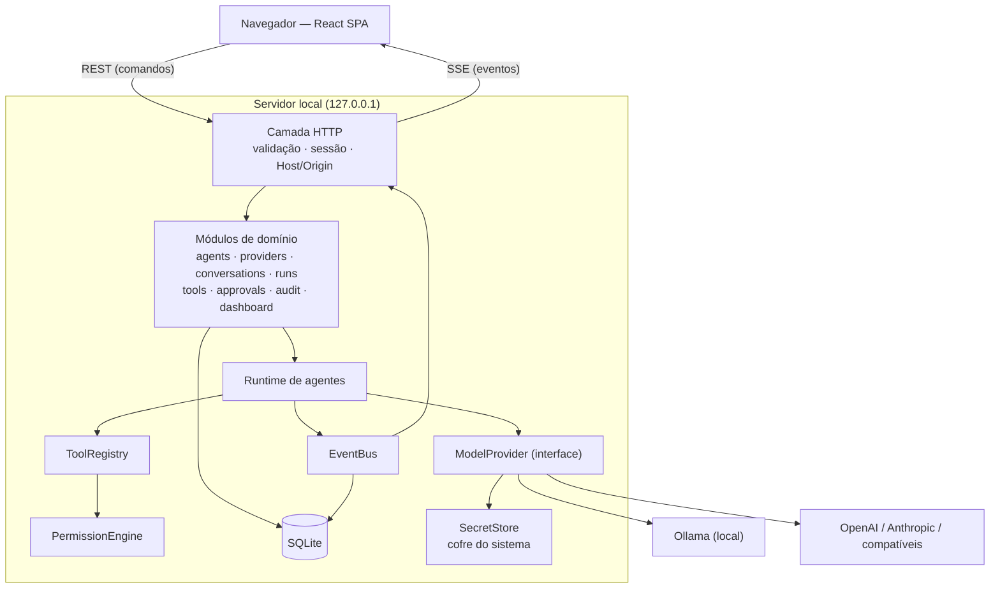
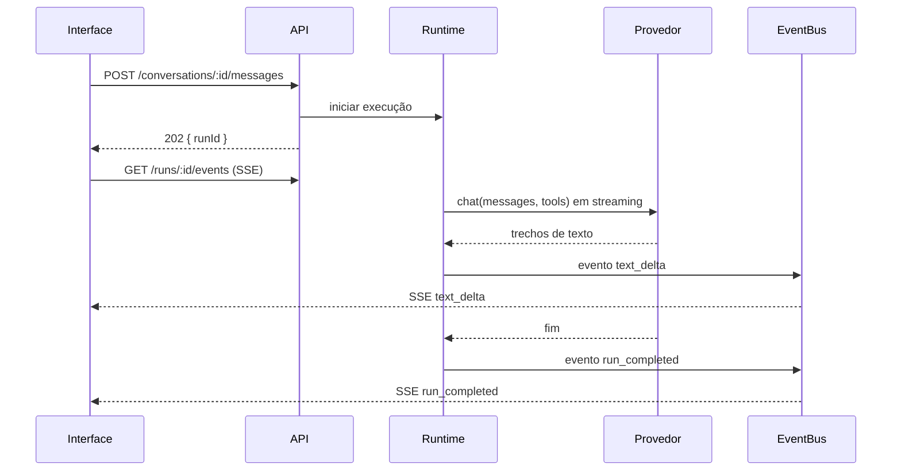

# ARCHITECTURE — Documentação arquitetural

> Estado: Fase 6. Estão implementados a camada HTTP, a configuração, a persistência (seção 7), a proteção de requisições (seção 11), a interface (seção 13) os módulos de leitura `dashboard`, `office`, `system` e `models`, os módulos `agents`, `projects` e `providers` com escrita, a camada de provedores (seção 6) e a auditoria. Runtime, provedores, ferramentas e EventBus continuam como projeto e serão confirmados ou corrigidos quando forem escritos.

## 1. Visão geral

Monólito modular local. Um único processo Node serve a API e a interface já compilada, com um banco SQLite em arquivo. Não há serviços externos obrigatórios.



## 2. Stack

| Camada | Tecnologia |
|---|---|
| Linguagem | TypeScript estrito |
| Monorepo | npm workspaces |
| Backend | Node 22, Fastify, Zod |
| Banco | SQLite (`better-sqlite3`), Drizzle ORM e migrações |
| Tempo real | Server-Sent Events |
| Frontend | React 19, Vite, Tailwind CSS 4, TanStack Query, React Router 7, lucide-react (ícones), Bricolage Grotesque (fonte embutida) |
| Segredos | `@napi-rs/keyring` (Credential Manager / Keychain / Secret Service) |
| Testes | Vitest, `fastify.inject`, Testing Library, Playwright |

## 3. Estrutura de diretórios

```
/
├─ apps/
│  ├─ server/
│  │  ├─ src/
│  │  │  ├─ config/        # leitura e validação do ambiente
│  │  │  ├─ core/          # erros de domínio, usados por todas as camadas
│  │  │  ├─ db/            # esquema Drizzle, migrações, conexão
│  │  │  ├─ http/          # servidor, plugins, tratamento de erros, SSE
│  │  │  ├─ security/      # sessão, Host/Origin, SecretStore, redação de logs
│  │  │  ├─ modules/       # um diretório por domínio (rotas, serviço, repositório)
│  │  │  ├─ runtime/       # loop do agente, limites, cancelamento, EventBus
│  │  │  ├─ providers/     # ModelProvider e adaptadores
│  │  │  └─ tools/         # ToolRegistry, PermissionEngine, ferramentas
│  │  └─ test/
│  └─ web/
│     ├─ src/
│     │  ├─ app/           # rotas, layout, provedores de contexto
│     │  ├─ components/    # componentes visuais reutilizáveis
│     │  ├─ features/      # dashboard, agents, chat, models, tools, logs, office
│     │  └─ lib/           # cliente de API, cliente SSE, utilitários
│     └─ e2e/              # Playwright
├─ packages/
│  └─ shared/              # esquemas Zod e tipos compartilhados (contrato da API)
├─ data/                   # banco e pastas de trabalho (ignorado pelo git)
└─ *.md                    # documentação
```

## 4. Componentes e responsabilidades

| Componente | Responsabilidade | Não faz |
|---|---|---|
| Camada HTTP | Roteamento, validação de entrada e saída, sessão, formato de erro, SSE. | Regra de negócio. |
| Módulos de domínio | Regras de negócio e persistência de cada entidade. | Chamar provedores diretamente. |
| Runtime | Conduzir uma execução: montar contexto, chamar o modelo, despachar ferramentas, aplicar limites, cancelar. | Decidir permissões; persistir direto no banco. |
| ModelProvider | Traduzir uma requisição neutra para a API de cada provedor e devolver um fluxo de eventos neutro. | Conhecer agentes ou ferramentas concretas. |
| ToolRegistry | Catálogo de ferramentas, com esquema de entrada e nível de risco. | Autorizar. |
| PermissionEngine | Decidir `allow`, `ask` ou `deny` para cada chamada, a partir da configuração do agente. | Executar. |
| EventBus | Receber eventos do runtime, persistir e distribuir aos assinantes SSE. | Interpretar eventos. |
| SecretStore | Guardar e recuperar credenciais no cofre do sistema. | Expor segredos à camada HTTP. |

Regra de dependência: `http → modules → runtime → providers/tools`. Camadas internas não importam as externas. O pacote `shared` não depende de nada do servidor nem da interface.

## 5. Fluxos de dados

### 5.1 Mensagem de chat com streaming



O POST retorna imediatamente; o progresso chega pelo SSE. Se a conexão cair, a interface reabre o SSE informando o último evento recebido e o servidor reenvia o que faltou a partir do banco.

### 5.2 Chamada de ferramenta com aprovação

1. O modelo emite uma chamada de ferramenta.
2. O runtime valida os argumentos contra o esquema da ferramenta.
3. O `PermissionEngine` responde:
   - `deny`: o modelo recebe um resultado de erro e a execução continua;
   - `allow`: a ferramenta executa;
   - `ask`: cria-se uma aprovação, a execução vai para `waiting_approval` e o runtime aguarda.
4. O usuário decide pela interface (`POST /approvals/:id/decision`).
5. Aprovado, a ferramenta executa; negado, o modelo recebe a negativa como resultado.
6. Tudo vira `run_step` e, quando sensível, registro de auditoria.

### 5.3 Delegação

`delegate_to_agent` é uma ferramenta como as outras. Ao executar, cria uma execução filha (`parent_run_id`) para o agente alvo, aguarda o resultado e o devolve como resultado da ferramenta. O cancelamento da execução pai propaga para as filhas.

## 6. Contratos internos

Formas simplificadas; a definição final fica em `packages/shared` e `apps/server/src/providers`.

```ts
interface ModelProvider {
  listModels(): Promise<ModelInfo[]>;
  testConnection(): Promise<ConnectionResult>;
  chat(request: ChatRequest, signal: AbortSignal): AsyncIterable<ChatEvent>;
}

type ChatEvent =
  | { type: 'text_delta'; text: string }
  | { type: 'tool_call'; id: string; name: string; arguments: unknown }
  | { type: 'usage'; inputTokens: number; outputTokens: number }
  | { type: 'done'; stopReason: 'end' | 'tool_use' | 'max_tokens' };

interface ToolDefinition<I> {
  name: string;
  description: string;
  inputSchema: ZodType<I>;
  risk: 'low' | 'medium' | 'high';
  execute(input: I, ctx: ToolContext): Promise<ToolResult>;
}
```

Estado em código (Fase 6): `ModelProvider` tem `testConnection`, `listModels` e `chat`, cada um aceitando um `AbortSignal`. `ChatRequest` ainda não leva ferramentas, e `ChatEvent` ainda não tem `tool_call`; os dois entram na Fase 8. O motivo de parada é `end`, `max_tokens` ou `refusal`.

Adaptadores lançam apenas `ProviderError`, cuja mensagem é uma frase fixa escolhida pelo tipo do erro (`unreachable`, `timeout`, `unauthorized`, `not_found`, `rate_limited`, `rejected`, `server_error`, `invalid_response`, `cancelled`). O texto vindo do provedor fica em `upstreamDetail`, só para log e só depois de redigido. Toda resposta de provedor é validada com Zod.

`ToolContext` carrega o agente, a execução, a pasta de trabalho e o `AbortSignal`. Uma ferramenta nunca recebe acesso direto ao banco nem ao `SecretStore`.

## 7. Persistência

SQLite em `data/app.db`, modo WAL, chaves estrangeiras ativas. Migrações Drizzle aplicadas na inicialização.

| Tabela | Conteúdo |
|---|---|
| `projects` | Agrupadores de agentes. |
| `providers` | Tipo, URL base, se é externo, referência à credencial no cofre (nunca a credencial). |
| `models` | Modelos habilitados por provedor e suas capacidades (ferramentas, streaming). |
| `agents` | Configuração do agente, limites, estado ativo/inativo, exclusão lógica. |
| `agent_tools` | Ferramenta concedida ao agente e nível de permissão. |
| `conversations` | Conversas por agente. |
| `messages` | Mensagens (usuário, agente, resultado de ferramenta). |
| `runs` | Execuções, com `parent_run_id`, estado, tempos, uso de tokens, motivo de término. |
| `run_steps` | Eventos ordenados de cada execução. |
| `tool_calls` | Chamadas de ferramenta, argumentos, resultado, decisão de permissão. |
| `approvals` | Pedidos de aprovação e decisões. |
| `audit_log` | Operações sensíveis (somente inserção). |
| `settings` | Preferências da aplicação. |

Identificadores são ULIDs monotônicos gerados no servidor: o maior id é sempre a linha mais recente, e consultas dependem disso. Datas em UTC, ISO 8601.

## 8. Integrações

| Integração | Protocolo | Observações |
|---|---|---|
| Ollama | HTTP (`/api/version`, `/api/tags`, `/api/show`, `/api/chat`) | Sem credencial. O suporte a ferramentas vem das capacidades que o servidor informa. |
| OpenAI-compatível | HTTP(S) (`/models`, `/chat/completions`; o endereço inclui o prefixo `/v1`) | Cobre OpenAI, LM Studio, OpenRouter e similares. Usa `max_completion_tokens` só quando o host é `api.openai.com`; o protocolo não informa suporte a ferramentas, então nenhum é presumido. |
| Anthropic | HTTPS (Messages API) via SDK oficial | Não envia `temperature`: os modelos atuais recusam parâmetros de amostragem, então a temperatura do agente não se aplica a este provedor. |

Provedores externos recebem o prompt de sistema, o histórico da conversa, as definições de ferramentas e os resultados de ferramentas. A interface informa isso ao configurar o provedor e ao atribuí-lo a um agente.

## 9. Concorrência e ciclo de vida

- Cada execução é uma tarefa assíncrona com seu próprio `AbortController`.
- Um limite global de execuções simultâneas (configurável) evita sobrecarga; o excedente fica `queued`.
- Uma execução ativa por conversa (RN-06).
- No desligamento, o servidor cancela as execuções ativas; na inicialização, marca como `interrupted` as que ficaram abertas (RN-12).

## 10. Execução e empacotamento

- **Produção local (`npm start`):** o Vite compila a interface para `apps/web/dist`; o servidor a entrega como arquivos estáticos e devolve `index.html` para rotas desconhecidas fora de `/api`.
- **Desenvolvimento (`npm run dev`):** o Vite serve a interface em `127.0.0.1:5173` e encaminha `/api` ao servidor em `4317`. Só nesse modo a origem `:5173` é aceita.
- O servidor roda com `tsx`, sem etapa de compilação. Menos peças para manter; o custo é um arranque algumas centenas de milissegundos mais lento.
- O `.env` opcional fica na raiz e é lido pelo servidor e pelo Vite, para que os dois concordem nas portas.

## 11. Proteção de requisições

Toda requisição passa, nesta ordem, por:

1. **Host** na lista `127.0.0.1:porta` / `localhost:porta` (todas as rotas, inclusive estáticas).
2. **Sec-Fetch-Site**, quando presente, igual a `same-origin` ou `none` (rotas `/api`).
3. **Origin** na lista permitida, obrigatório em métodos que alteram estado (rotas `/api`).
4. **Cookie de sessão** válido (rotas `/api`, exceto `POST /api/session`, que o emite).

A interface chama `POST /api/session` ao abrir e repete a chamada uma vez se receber 401, pois o token muda a cada reinício do servidor.

## 12. Estado do agente

O estado exibido de um agente é derivado, nunca gravado. A única função que decide é `deriveAgentState` (`modules/agents/agent-state.ts`): inativo se desabilitado; aguardando você se alguma execução espera aprovação; trabalhando se há execução ativa; com falha se a última execução terminada falhou ou estourou o tempo; ocioso nos demais casos. Painel e Escritório usam a mesma consulta (`listAgentsWithState`).

## 13. Interface

Formulários validam no navegador com o mesmo esquema Zod que o servidor usa (`packages/shared/src/agents.ts`), então as duas pontas nunca divergem; o servidor valida de novo de qualquer forma. Toda alteração de agente ou projeto invalida as consultas de agentes, projetos, escritório e painel.

- `app/`: roteamento, layout, navegação e tema. `PLANNED_AREAS` em `navigation.ts` lista as áreas ainda não construídas; cada uma sai da lista quando sua página real entra em `router.tsx`.
- `components/`: peças visuais sem conhecimento de domínio.
- `features/<área>/`: uma pasta por tela.
- `lib/`: cliente da API (valida toda resposta com os esquemas de `@ea/shared`), consultas TanStack Query, formatação em pt-BR.
- Atualização dos dados por consulta periódica (5 s) até a Fase 7, quando entra o SSE.
- Sem estilos inline e sem recursos externos, para cumprir a CSP. Cores vêm dos tokens em `app/theme.css`; cor saturada significa sempre estado.

## 14. Evolução prevista

| Evolução | Ponto de extensão |
|---|---|
| Novo provedor | Novo adaptador de `ModelProvider`. |
| Nova ferramenta | Novo `ToolDefinition` registrado no `ToolRegistry`. |
| Fluxos de trabalho declarativos | Novo módulo que cria execuções encadeadas sobre o mesmo runtime. |
| Isolamento por contêiner | Novo executor para a ferramenta de script, atrás da mesma interface. |
| Aplicativo desktop | Empacotar o servidor e a interface com Tauri ou Electron. |
| Agentes baseados no Claude Agent SDK | Novo tipo de runtime emitindo os mesmos eventos do `EventBus`. |
