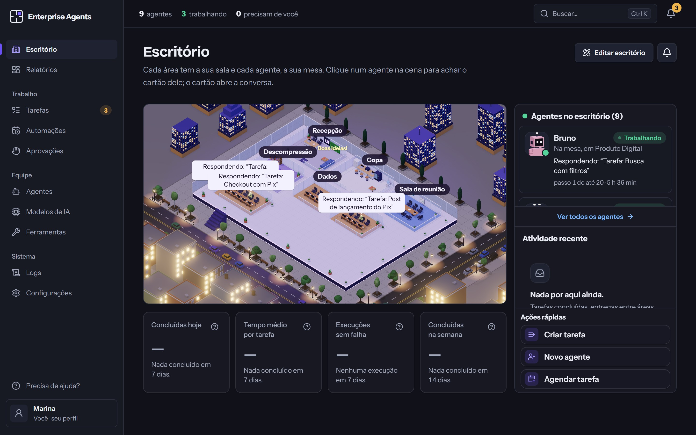
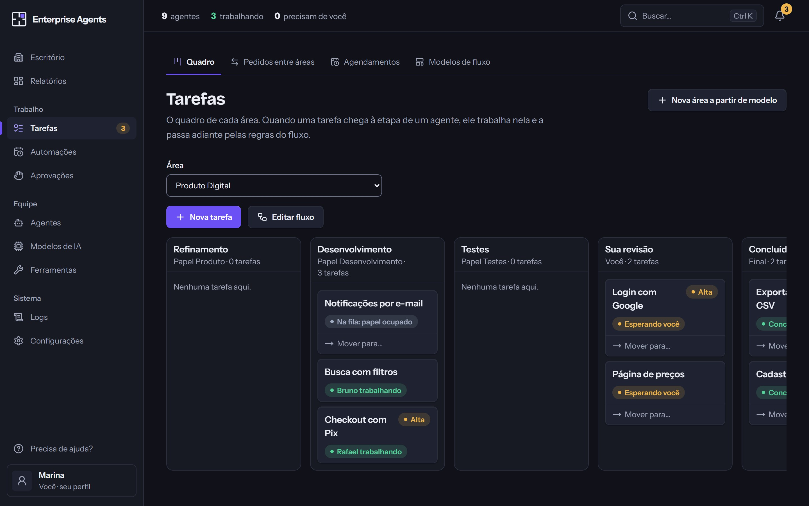
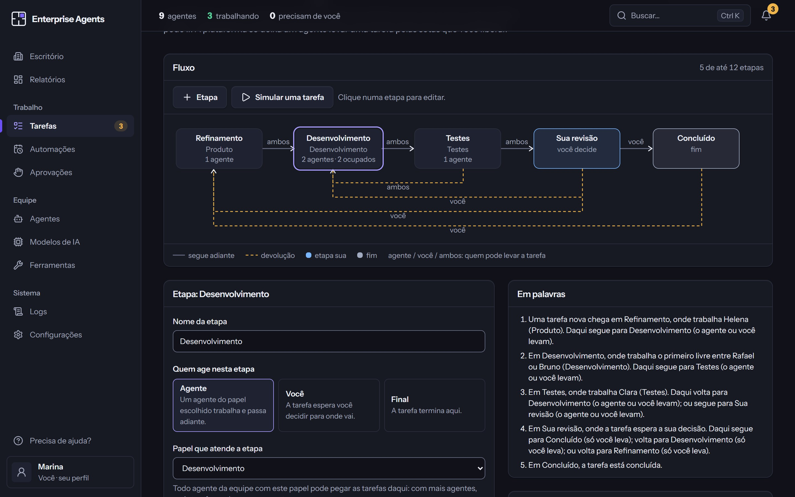
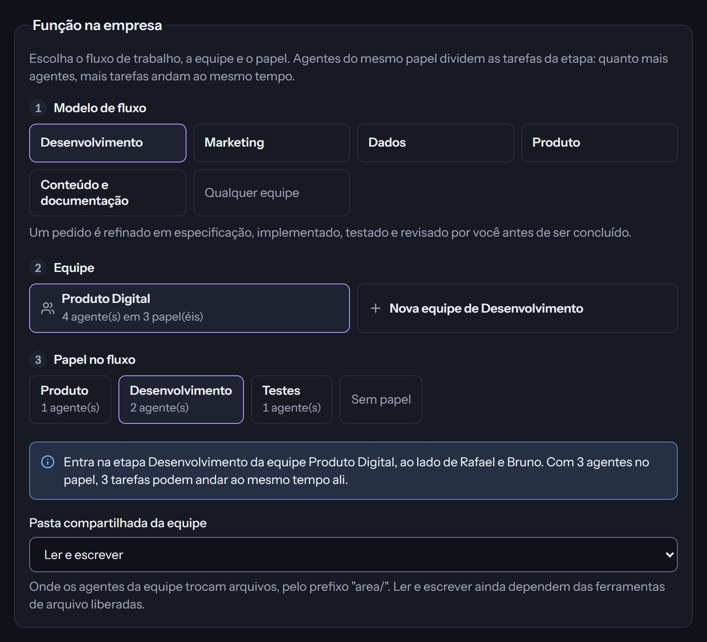
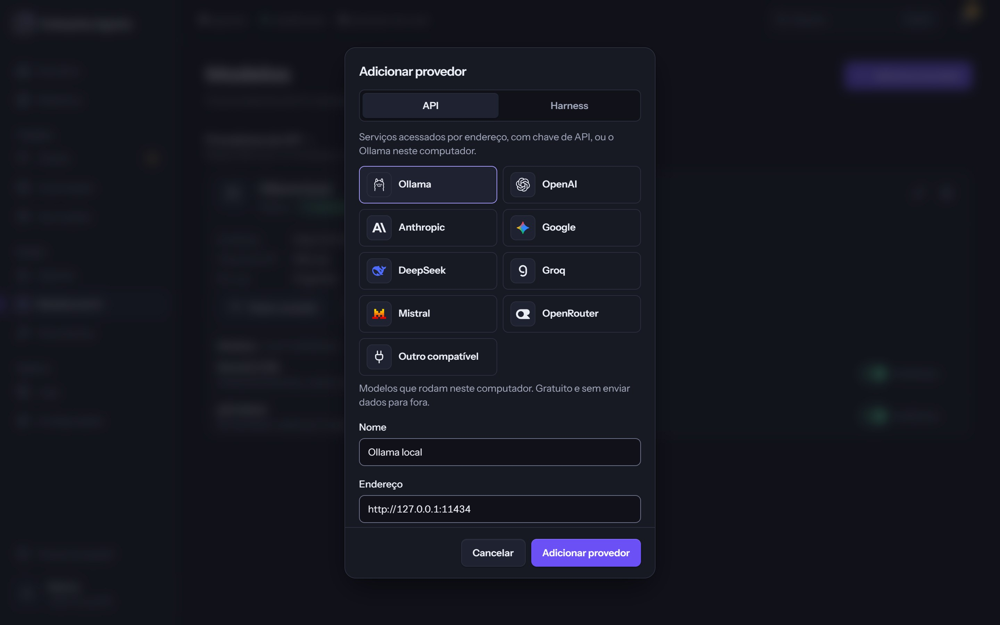

<div align="center">


# Enterprise Agents

**Uma empresa de agentes de IA rodando no seu computador.**

Monte equipes, defina como o trabalho anda e acompanhe tudo num escritório 3D,
com modelos locais ou na nuvem, sem que nada saia da sua máquina sem você saber.




</div>

## O que ele faz

- **Equipes com fluxo de trabalho.** Cada equipe tem um quadro e um fluxo (Refinamento → Desenvolvimento → Testes → Sua revisão, por exemplo). Os agentes pegam as tarefas, trabalham e passam adiante sozinhos, pelas regras que você definiu.
- **Papéis que escalam.** Dois agentes no papel de Dev tocam duas tarefas ao mesmo tempo. Uma tarefa devolvida volta para quem já trabalhou nela.
- **Você no controle.** Etapas de aprovação suas, ferramentas liberadas uma a uma, e cada ação sensível pedindo o seu "sim" antes de acontecer.
- **Escritório vivo em 3D.** Cada equipe tem a sua sala, e cada agente tem a sua mesa e o seu personagem. Seis ambientes externos, de dia e de noite.
- **Qualquer modelo.** Ollama no seu computador, OpenAI, Anthropic, Google, DeepSeek, Groq, Mistral e OpenRouter, ou o Claude Code e o Codex que você já usa.
- **Modelos prontos.** Desenvolvimento, Marketing, Dados, Produto e Conteúdo, com boas práticas embutidas, e os seus próprios fluxos salvos como modelo.

## Por dentro

<table>
  <tr>
    <td width="50%"></td>
    <td width="50%"></td>
  </tr>
  <tr>
    <td><b>Quadro de tarefas.</b> As tarefas andam sozinhas entre as etapas; arraste para mover quando a decisão é sua.</td>
    <td><b>Fluxo em desenho.</b> Etapas, setas e devoluções; o fluxo explicado em frases, avisos e uma simulação passo a passo.</td>
  </tr>
  <tr>
    <td></td>
    <td></td>
  </tr>
  <tr>
    <td><b>Função na empresa.</b> Escolha o modelo, a equipe e o papel; o agente já nasce com as instruções do cargo.</td>
    <td><b>Provedores.</b> Serviços de API e harness locais, cada um com o seu logotipo.</td>
  </tr>
</table>

## Comece em um minuto

Você precisa do [Node.js 22](https://nodejs.org) ou mais recente. Para modelos locais, instale também o [Ollama](https://ollama.com) e baixe um modelo (`ollama pull llama3.2:3b`).

```bash
npm install
npm start
```

Abra **http://127.0.0.1:4317**. Os primeiros passos guiam você por conectar um provedor, habilitar um modelo, criar a primeira equipe e mandar a primeira tarefa. O [guia de utilização](docs/GUIA.md) também está dentro da plataforma, em **Ajuda**.

## Seguro por padrão

- O servidor só escuta em `127.0.0.1`: a plataforma não fica exposta na rede.
- As chaves de API ficam no cofre de credenciais do sistema operacional, nunca no banco, nos logs ou no contexto enviado ao modelo.
- Um agente começa sem nenhuma ferramenta, e a pasta de trabalho de cada um é confinada a ele.
- Toda chamada de ferramenta passa pelo motor de permissões, e as operações sensíveis ficam numa auditoria que só aceita inserção.
- A saída dos modelos é tratada como dado não confiável e mostrada sem HTML nem imagens externas.

Os detalhes estão em [SECURITY.md](SECURITY.md).

## Para desenvolvedores

| Comando | O que faz |
|---|---|
| `npm run dev` | Servidor e interface com recarga automática. |
| `npm run check` | Tipos, lint e testes. |
| `npm run check:full` | Também cobertura e testes de ponta a ponta no navegador. |

Monólito modular em TypeScript: Fastify, SQLite (Drizzle), React 19, Tailwind, three.js e Playwright. Leia mais em [ARCHITECTURE.md](ARCHITECTURE.md), [SPEC.md](SPEC.md), [TESTING.md](TESTING.md) e [ROADMAP.md](ROADMAP.md).

<div align="center">
<sub>Feito para rodar na sua máquina. Seus agentes, seus dados.</sub>
</div>
